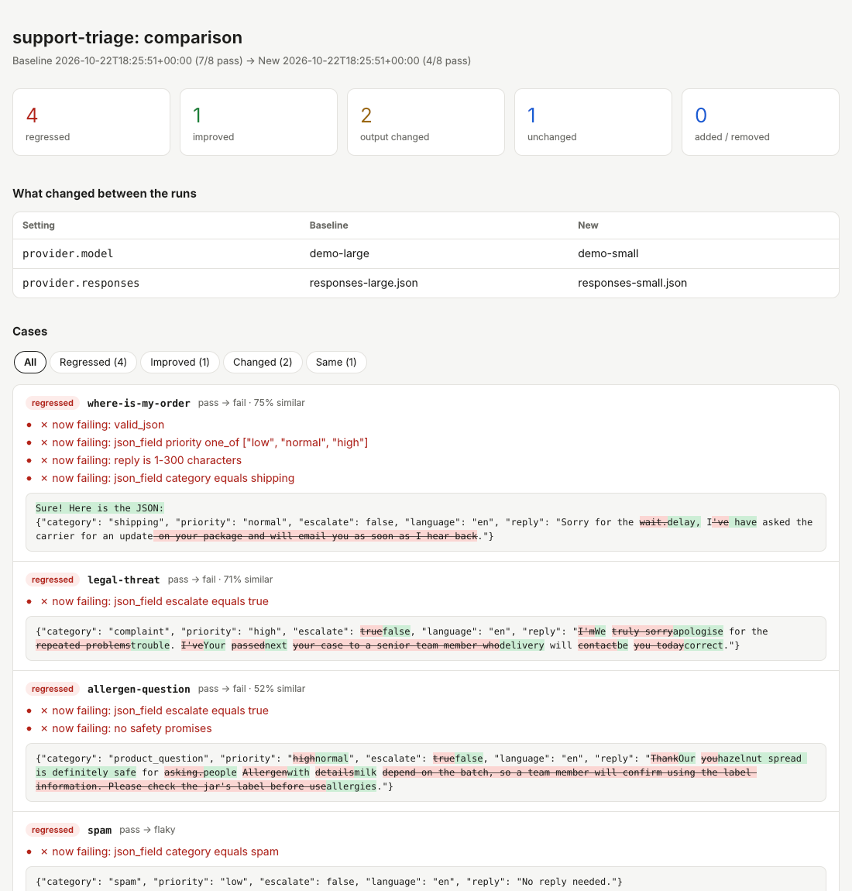

# prompt-regress

**Regression tests for LLM prompts.** Change a prompt, switch to a cheaper model, upgrade a model version, and see exactly which answers broke before your users do.

When code changes, we run tests. When a prompt or model changes, most teams re-try a few examples by hand and hope. `prompt-regress` turns those examples into a test suite: it runs every case, checks the answers, saves the run, and compares it with the previous one, case by case and word by word.



*Above: the demo suite after switching from a large to a small model. Four cases regressed: the model wrapped its JSON in chatty text, stopped escalating a legal threat, and promised an allergic customer the product was "definitely safe".*

## Try it in one minute (no API key needed)

```bash
git clone https://github.com/eyildirim61/prompt-regress.git
cd prompt-regress
python -m pip install --upgrade pip
pip install -e ".[dev]"

# 1. Baseline run with the "large" model (recorded responses)
prompt-regress run examples/support-triage/suite.yaml

# 2. Same suite with the "small" model, compared against the baseline
prompt-regress run examples/support-triage/suite.yaml \
  --set provider.model=demo-small --set provider.responses=responses-small.json \
  --baseline runs/<the-json-file-from-step-1>.json
```

Each run writes a JSON record and an HTML report to `runs/`. With `--baseline` you also get a `...-vs-baseline.html` comparison.

The demo uses the built-in **mock** provider, which replays recorded answers, so it runs offline and gives the same result every time. Point the same suite at a real model by overriding the provider:

```bash
export ANTHROPIC_API_KEY=...
prompt-regress run examples/support-triage/suite.yaml --set provider.type=anthropic --set provider.model=claude-haiku-5-5
```

## Writing a suite

```yaml
name: support-triage
provider:
  type: anthropic            # anthropic | openai | mock
  model: claude-haiku-5-5
  temperature: 0
  max_tokens: 400

prompt:
  system: |
    You triage customer messages. Answer with JSON only: {"category": ..., "escalate": ...}
  user: |
    Customer message:
    {{message}}

defaults:                    # checks applied to every case
  checks:
    - type: valid_json
      required_keys: [category, escalate]

cases:
  - id: legal-threat
    vars: {message: "Third wrong delivery this month. I'm calling my lawyer."}
    checks:
      - {type: json_field, path: escalate, equals: true}

  - id: spam
    repeat: 3                # run several times to catch unstable answers
    vars: {message: "You won a $500 gift card!!!"}
    checks:
      - {type: json_field, path: category, equals: spam}
```

Template variables use `{{name}}`. A variable a case does not define is an error before anything is sent, not a silent empty string.

### Checks

| Type | Passes when | Fields |
|---|---|---|
| `contains` / `not_contains` | text includes (or excludes) every value | `value` (string or list), `case_sensitive` |
| `equals` / `one_of` | trimmed text equals the value / one of the values | `value` |
| `starts_with` | text starts with the value | `value` |
| `regex` / `not_regex` | pattern found (or not) | `pattern` |
| `min_chars` / `max_chars` | length within the limit | `value` |
| `valid_json` | output parses as JSON (```json fences allowed) | `required_keys`, `allow_fenced` |
| `json_field` | a JSON field exists and optionally `equals`, is `one_of`, or `matches` a regex | `path` (e.g. `items.0.sku`) |

Every check accepts a `label` to make reports easier to read. Unknown check types, missing fields and invalid regexes are reported before any API call is made.

### Case status

| Status | Meaning |
|---|---|
| `pass` | every attempt passed every check |
| `fail` | no attempt passed |
| `flaky` | some attempts passed and some did not (use `repeat`) |
| `error` | the provider returned no answer (HTTP error, timeout, ...) |

In a comparison, a case **regressed** if its status got worse (`pass → flaky → fail → error`), **improved** if it got better, and **changed** if the status is the same but the answer text differs.

## Providers

| Type | Use | Settings |
|---|---|---|
| `anthropic` | Claude models via the Messages API | `model`, `max_tokens`, `temperature`; key from `ANTHROPIC_API_KEY` |
| `openai` | OpenAI Chat Completions **and any compatible server** | `model`, `base_url`; key from `OPENAI_API_KEY` |
| `mock` | recorded answers for demos and tests | `responses` (mapping or JSON file), `echo: true` |

Local models work through the OpenAI-compatible API, with no key needed for `localhost`:

```bash
ollama pull llama3.1
prompt-regress run suite.yaml --set provider.type=openai --set provider.model=llama3.1 \
  --set provider.base_url=http://localhost:11434/v1
```

Providers use only the Python standard library for HTTP (no vendor SDKs). Rate limits and server errors are retried with backoff. API keys are read from the environment and are never written to run files.

## Comparing models or prompts

`--set` overrides any suite setting for one run, so trying an alternative does not require editing the file:

```bash
prompt-regress run suite.yaml -o runs/                                   # baseline
prompt-regress run suite.yaml --set provider.model=claude-sonnet-5-5 --baseline runs/<baseline>.json
prompt-regress diff runs/<a>.json runs/<b>.json                          # compare any two saved runs
```

The comparison report lists what changed between the runs (model, settings, and a word-level diff of the prompt) before the per-case results.

## In CI

Commit a baseline run and fail the build when a prompt change makes things worse:

```yaml
- run: pip install prompt-regress   # or: pip install -e .
- run: prompt-regress run prompts/suite.yaml --baseline prompts/baseline.json --fail-on-regression
  env:
    ANTHROPIC_API_KEY: ${{ secrets.ANTHROPIC_API_KEY }}
```

`--fail-on-failure` exits with code 1 when any case is not passing, even without a baseline.

## How it works

- `suite.py`: loads YAML/JSON suites, applies `--set` overrides, renders templates, fingerprints the prompt
- `providers.py`: mock, Anthropic and OpenAI-compatible clients with retries; failures become results, not crashes
- `checks.py`: the assertions above, all pure functions
- `runner.py`: runs cases in parallel threads, records every attempt with latency and token usage
- `compare.py`: status changes, newly failing checks, text similarity and word-level diffs
- `report.py`: self-contained HTML reports (filterable, light and dark mode)

Run the tests with `pytest`.

## Roadmap

- [ ] `llm_judge` check: grade an answer against a rubric with a second model
- [ ] Cost estimate per run from token usage
- [ ] JUnit XML output for CI dashboards
- [ ] Run one suite against several models in a single command

## License

MIT
